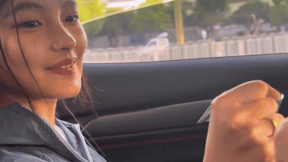

<div align="center">

# 拾遗馆

### 她拍下的都是真的，我难受也是。

**一个小天才（余乐彤）作品的私人归档站，外加一封没寄出的信。**

🌐 **[xtc.caiths.com](https://xtc.caiths.com)**

<a href="https://raw.githubusercontent.com/poboll/xiaotiancai/main/media/nvzhu.mp4"></a>

<sub>《女主》禁止上船，后果自负 · 结尾四秒。点它看完整 82 秒。</sub>

</div>

---

## 为什么有这个地方

我是从《龙龙历险记》那条南瓜饼的视频入坑的。

她把南瓜饼递过去，他愣了一下。就那半秒，我信了——人在被真心对待的时候，脸上是空的，来不及想镜头，也来不及想该摆什么表情。这个演不出来。

那之后我把她主页从头翻到尾，翻到半夜。翻出来的不只是她的东西，还有我自己那堆旧账：高中暗恋过一个人，没说过；大学那段关系悬了很久，暧昧到谁也没捅破那层纸；后来和初恋「呆呆」在一起，一年半，到现在还算稳。按理说是好结局。可我坐在那儿想，大学那几年我几乎没带她出去玩过——没去过什么地方，也没有过那种「两个人走了很远，回来路上一句话不说但心里很满」的时候。

**我把最好的年纪，用来犹豫了。**

看完他们的故事才反应过来：两个人能顺顺当当地在一起，是千百年修来的缘份。多数人不是不爱，是差一口气——差在时间上，差在谁先开口上。他们差的不是爱，是别的。

所以这个站一半是给她存档，一半是给自己留个证据。她的每一条我都留着：樱花树下等人、海边、雪里、她自己觉得好看的那点光——这些东西跟那个故事有没有结局没关系，它们本身就该留着。

那封信我单独做成了能打印的一版，想挂起来。

不是为了记住一个悲剧。是提醒自己：**遇到对的人，别犹豫。**

> 完整版在站里：[我为什么收这些](https://xtc.caiths.com/story.html)

---

## 站里有什么

| 页面 | 作用 |
|:---|:---|
| [`index.html`](index.html) | 首页。128 部作品的瀑布流，可按图文/视频/平台/年份筛，可按时间或热度排 |
| [`story.html`](story.html) | 「我为什么收这些」，上面那段话的完整版 |
| [`work.html?w=<id>`](work.html) | 单部作品详情：图片竖排可点开大图；视频作品带封面和全片文稿 |
| [`works/longlong-xiaotiancai/`](works/longlong-xiaotiancai/index.html) | 《致王卓凡》那封信：正文 + 故事梗概 + 我的观后感 + 精选评论 + 两集自剪片段 |
| [`404.html`](404.html) | 链接失效时的兜底页，老链接会尽量救回作品页 |

---

## 自己跑起来

```bash
git clone https://github.com/poboll/xiaotiancai.git
cd xiaotiancai
python3 -m http.server 8899
# 打开 http://127.0.0.1:8899
```

推到 `main` 就自动部署，线上地址 <https://xtc.caiths.com>。

**加一部新作品**：把带 `info.json` 的文件夹丢进 `抖音源/` 或 `小红书源/`，跑 `python3 scripts/build_library.py`，提交推送。不用碰任何 HTML。

**改置顶、改开场白**：全在 [`data/works.js`](data/works.js) 顶上。

---

## 相关

- **[`docs/实现笔记.md`](docs/实现笔记.md)** — 这个站怎么搭的：原图通道怎么挖的、清晰度实测、体积与 LFS 的账、去重逻辑、域名与部署。实现细节都在这儿，README 不掺和技术。
- **[`video-parse`](https://github.com/poboll/video-parse)** — 从这站里长出来的解析器：抖音 + 小红书通用视频/图文化解析，Playwright 驱动，带登录态持久化。

---

## 版权

站内所有影像、文字版权归原作者 **小天才.（余乐彤）** 所有。这里只做个人收藏和阅读记录，不用于任何商业用途，也不接广告。如果作者本人希望撤下，删掉对应文件夹即可。
